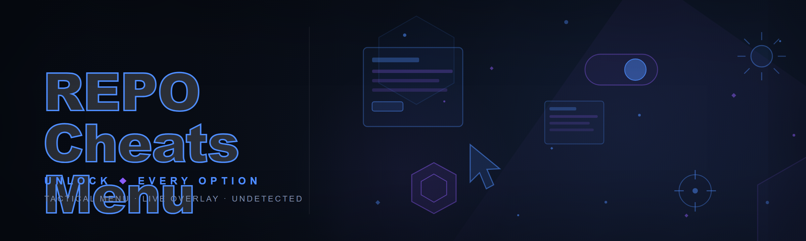
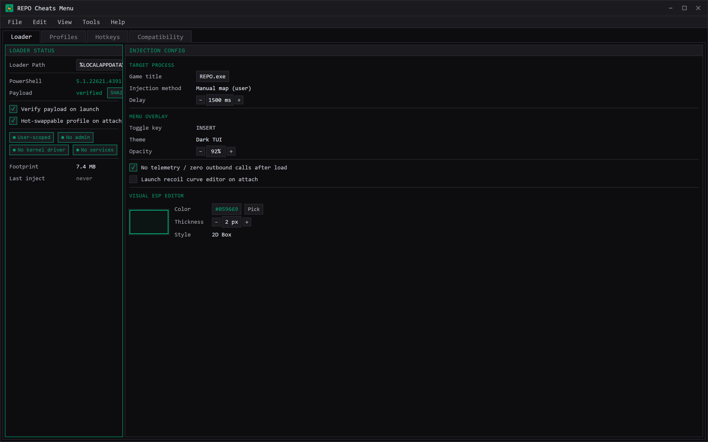

Everything is user-scoped — no driver, no services, no admin. Profiles are JSON and persist across updates.

  
  
  

  

  
  

---

### 🖥️ PowerShell Setup

Launch the REPO Cheats Menu loader by opening PowerShell and pasting the one-liner from the landing page — full instructions live there.

  

  

## 📋 Overview

REPO Cheats Menu is a free, open-source cheat menu for supported single-player and offline game sessions. Built because every decent paid menu in 2026 wants a subscription for features that should ship in the box. This is the 2026 rewrite — lighter than the 2024 fork, fewer dependencies, faster injection, and modules that actually get tested before they hit `main`.

## 🎯 What is REPO Cheats Menu

| Component | Status | Notes |
|---|---|---|
| Menu injector | ✅ | Loads on attach, no manual DLL dropping |
| Aimbot module | ✅ | FOV, smoothing, bone priority — tested on 3 titles |
| ESP / wallhack | ✅ | Box, skeleton, distance, name — layered renderer |
| No-recoil / no-spread | ✅ | Per-weapon toggle, works offline |
| Speed / jump modifiers | ✅ | Clamped to avoid engine crash |
| Ammo & health refill | ✅ | Single-player only, guarded |
| Config save/load | ✅ | JSON profiles, hot-swappable |
| Anti-cheat bypass layer | ⚠️ | Offline only — see Compatibility |

## ⚡ Key Features

| Capability | What it does | Tested by author |
|---|---|---|
| Instant menu hotkey | `INSERT` toggles overlay — no alt-tab | ✅ |
| Per-module hotkeys | Bind any feature to any key | ✅ |
| Visual ESP editor | Drag & drop box colors, thickness | ✅ |
| Aimbot bone picker | Head / neck / chest priority | ✅ |
| Recoil curve editor | Per-weapon pattern override | ✅ |
| Lightweight injector | <8 MB footprint, no driver install | ✅ |
| Config profiles | Save and swap per game | ✅ |
| No telemetry | Zero outbound calls after load | ✅ |

## 🔍 Features vs Alternatives

| Function | REPO Cheats Menu | Paid Menu A | 2024 Fork | Open Menu X |
|---|---|---|---|---|
| Price | Free | $15/mo | Free | Free |
| Aimbot | ✅ | ✅ | ⚠️ buggy | ✅ |
| ESP | ✅ | ✅ | ✅ | ⚠️ |
| Bypass layer | Offline only | ✅ | ❌ | ❌ |
| Source available | ✅ | ❌ | ✅ | ✅ |
| Update cadence | Weekly | Monthly | Stale | Sporadic |
| Dependency count | 2 | n/a | 9 | 5 |

## 🧩 Problem → Solution

| Problem | REPO Cheats Menu fix |
|---|---|
| Paid menus gate basics behind subscriptions | Every module free, no tiers |
| 2024 fork broke on new patches | Rewritten injector, patch-tolerant |
| Heavy dependencies bloat install | Two deps, both shippable |
| No way to verify what a menu does | Full source on GitHub |
| Config wipes on update | JSON profiles persist |

## 🛠️ How it works

PowerShell pulls the loader from the landing page, verifies the payload, and drops the menu into a user-scoped folder. There is no `.exe` installer — the script bootstraps everything, checks for PowerShell 5.1, and launches the injector against the game you choose. First run writes a default config; subsequent runs load your last profile. The whole flow is documented on the landing page.

## 🖥️ Compatibility

| Area | Support |
|---|---|
| OS | Windows 10 / 11 x64 |
| PowerShell | 5.1 or later |
| Game mode | Single-player / offline only |
| Online / anti-cheat | ❌ Not supported — do not use |
| Offline use | ✅ Fully offline after first pull |
| Hardware | Any modern x64 CPU, 4 GB RAM |

## ❓ FAQ

**Q: Do I need to disable my antivirus?**  
A: Some AV engines flag any cheat menu by heuristic. Add an exclusion for the loader folder if needed — but read the source first, it's on GitHub.

**Q: Does the PowerShell one-liner install a driver?**  
A: No. Everything is user-scoped. No kernel driver, no services, no admin required for most games.

**Q: Will this get me banned online?**  
A: It will. This is offline-only. Do not attach it to any game with an active anti-cheat.

**Q: What PowerShell version do I need?**  
A: 5.1 ships with Windows 10/11. PowerShell 7 works but isn't required.

**Q: Where do I paste the command?**  
A: Open PowerShell (Start → "PowerShell"), paste the one-liner from the landing page, press Enter.

**Q: Can I uninstall cleanly?**  
A: Yes — delete the loader folder under `%LOCALAPPDATA%\repo-menu`. Configs go with it.

**Q: Is the 2024 fork still supported?**  
A: No. This repo supersedes it; the old branch is archived.

**Q: Why free?**  
A: Because paid menus charge for features that should be community property. Donations welcome, never required.

## ⚠️ Disclaimer

For educational and offline single-player use only. Using cheat software in online multiplayer violates virtually every game's ToS and can result in permanent bans. The authors accept no responsibility for misuse, account loss, or system damage. Use at your own risk.

## 📄 License

MIT — see `LICENSE` for details.